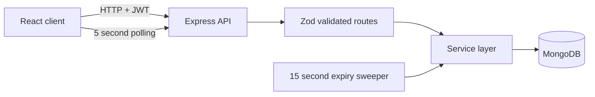
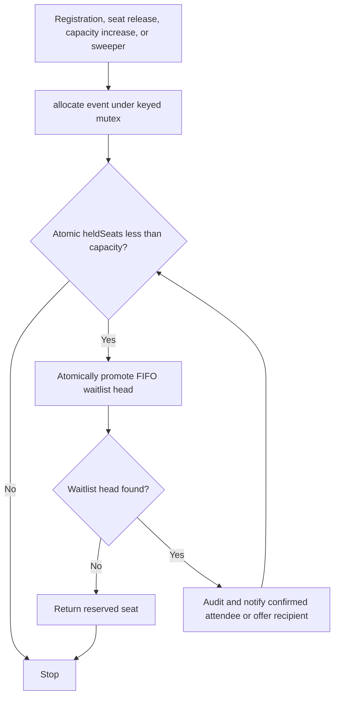
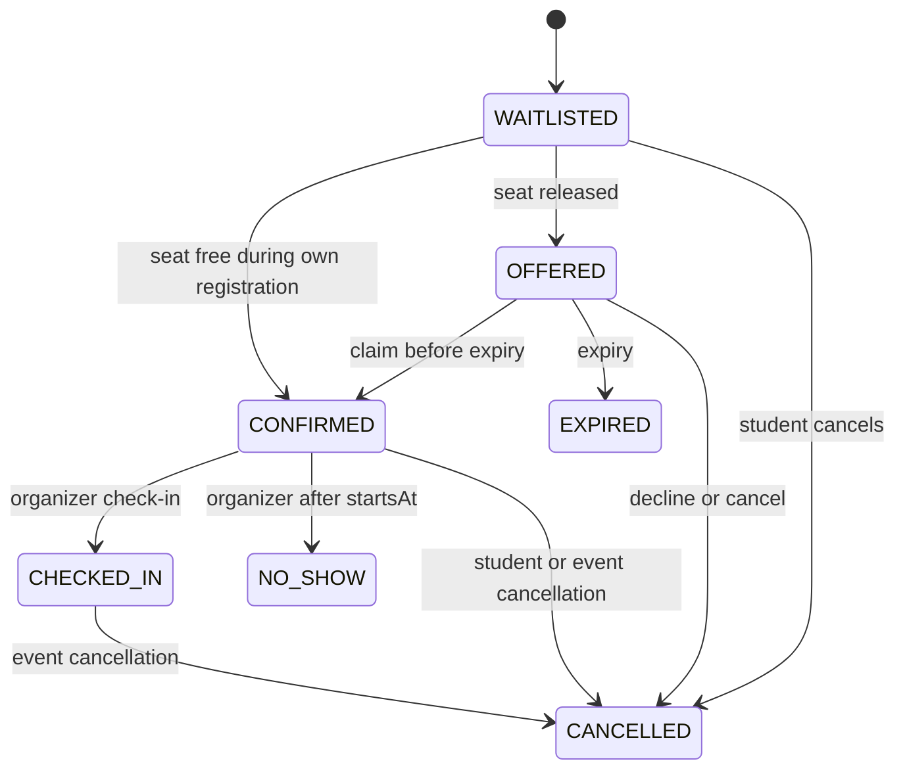

# Project Name

SeatFlow

## Problem Statement

Popular campus events fill quickly. Students who arrive later need a fair queue, and organizers need a safe way to reuse seats that open up.

## Target Users

Student event organizers and students attending campus workshops, talks, and fest events.

## Solution

SeatFlow manages registration with capacity-safe confirmation and a first-in, first-out waitlist. When a seat opens, the waitlist head receives a time-limited offer.

## Key Features

- Organizer accounts can create, edit, publish, and cancel events.
- Students can register, view their queue position, claim or decline offers, and cancel registrations.
- Offers move one at a time in FIFO order; expired or declined offers cascade to the next person.
- Organizers can view attendees, check attendees in, mark no-shows after the event starts, and review an audit log.
- In-app notifications and polling keep pages current without a push service.
- Public browsing shows future published events; cancelled event details remain available.

## Tech Stack

- React, Vite, and React Router
- Node.js, Express, Mongoose, and MongoDB
- JWT, bcryptjs, Zod, Helmet, CORS, and express-rate-limit
- Jest, Supertest, and mongodb-memory-server

## Architecture

### Components



### Allocation flow



### Registration state machine



## Concurrency Guarantees

Safety comes from guarded MongoDB atomic updates: seat acquisition checks `heldSeats < capacity`, status transitions check the expected prior status, and a partial unique index prevents duplicate active registrations. The per-event in-process lock makes instant confirmation deterministic for a single API process; safety does not depend on that lock. The test suite includes lock-free concurrent allocation and a repeated 50-request instant-confirm regression.

The deployed timing fields below are intentionally placeholders for the human to fill after measuring the current deployment:

```text
50-request deployed load test: 10 confirmed, 40 waitlisted, heldSeats 10.
Warm run: WARM_SECONDS seconds.
Cold-start run: COLD_SECONDS seconds.
```

The local run output is recorded in [`docs/loadtest-output.txt`](docs/loadtest-output.txt). Replace both timing placeholders with measured values before presenting deployment performance.

```text
Completed 50 parallel requests in 993ms.
HTTP status breakdown: {"201":50}
- Confirmed count: 10 (expected 10)
- Waitlisted count: 40 (expected 40)
- Held seats: 10 (expected 10)
- Unique sequence numbers: 50/50 (no duplicate seq)
>>> Scenario 1: PASS
HTTP status breakdown: {"201":1,"409":19}
>>> Scenario 2: PASS
OVERALL RESULT: PASS
```

## Local Setup

Requirements: Node.js/npm and a MongoDB server. Run these commands from the repository root:

```sh
test -f server/.env || cp server/.env.example server/.env
test -f client/.env || cp client/.env.example client/.env
cd server
npm install
MONGO_URI=mongodb://localhost:27017/seatflow npm run dev
```

In a second terminal, from the repository root:

```sh
cd client
npm install
npm run dev
```

The API listens on `http://localhost:5001`; Vite prints the client URL (default `http://localhost:5173`). The sample Mongo URI targets a local database named `seatflow`.

To create the demo data explicitly, run `cd server && npm run seed`. The seed command can be rerun; it replaces only events titled `DEMO ` owned by the demo organizer and upserts the demo accounts. `npm run cleanup` is a dry run. `npm run cleanup -- --confirm` requires typing the configured database name before deletion. `npm run reset-demo` performs that confirmed cleanup, then reseeds.

## Environment Variables

### Server (`server/.env`)

| Variable | Purpose | Example value |
| --- | --- | --- |
| `PORT` | HTTP port | `5001` |
| `NODE_ENV` | Runtime mode | `development` |
| `MONGO_URI` | MongoDB connection URI | `mongodb://localhost:27017/seatflow` |
| `JWT_SECRET` | JWT signing secret; production requires a unique value of at least 32 characters | `replace_with_a_random_secret_at_least_32_characters_long` |
| `CLIENT_ORIGIN` | Single allowed browser origin | `http://localhost:5173` |
| `OFFER_MINUTES` | Offer duration in minutes | `10` |
| `ORGANIZER_INVITE_CODE` | Optional organizer signup code | `replace_with_optional_invite_code` |

### Client (`client/.env`)

| Variable | Purpose | Example value |
| --- | --- | --- |
| `VITE_API_URL` | API base URL; must end in `/api` | `http://localhost:5001/api` |

Use real credentials only in untracked local environment files or deployment settings. Never commit `.env` files.

## Deployment

- Client: [https://seat-flow-delta.vercel.app](https://seat-flow-delta.vercel.app)
- API: [https://seatflow-92rg.onrender.com](https://seatflow-92rg.onrender.com)
- Render's free service may sleep; the first request after inactivity can have a cold start. Visit `/api/health` before a demo.

Demo login for the organizer and all five students:

```text
Password: SeatFlowDemo!2026
Organizer: demo.organizer@seatflow.test
Students: demo.student1@seatflow.test through demo.student5@seatflow.test
```

Create the demo accounts/events by running `npm run seed` from `server/` against the intended database.

## Testing

Run the API suite and client build:

```sh
cd server && npm test
cd ../client && npm run build
```

For the local load test, first point both the API and load-test command to the same disposable local MongoDB database. Confirm the database target before running; the test creates and deletes tagged records. Start exactly one fresh API process on port 5001 (`lsof -i :5001`), then from `server/` run:

```sh
MONGO_URI=mongodb://localhost:27017/seatflow API_URL=http://localhost:5001/api npm run loadtest
```

The script reads `JWT_SECRET` and `MONGO_URI` from `server/.env` or the environment, sends 50 parallel registrations and a 20-request duplicate-registration scenario, checks the database invariants, prints status counts and any first error body, removes its uniquely tagged data in `finally`, and writes `docs/loadtest-output.txt`. Expected result: Scenario 1 has 10 confirmed and 40 waitlisted with `heldSeats` 10; Scenario 2 has one registration, one 201, and nineteen 409 responses.

Against the deployed API, wait for the current API deployment to be live, then from `server/` provide the deployment's values through the environment (do not write them to a file):

```sh
: "${JWT_SECRET:?Set the deployed JWT_SECRET in this shell}"
: "${MONGO_URI:?Set the deployed MONGO_URI in this shell}"
API_URL=https://seatflow-92rg.onrender.com/api npm run loadtest
```

This test creates and deletes tagged records in the selected database. Confirm the target before running it.

## Design Decisions

See [`docs/decisions.md`](docs/decisions.md) for the partial unique index, one-at-a-time offers, safety versus liveness, expiry, reconciliation, polling, allocation lock, registration flag, and known trade-offs.

## AI Usage

> **DRAFT — human edit required:** AI assistance was used to implement and document parts of this project. The project owner should review this statement, specify the tools and work they want disclosed, and edit it to match their actual usage before submission.

## Known Limitations

- The allocation lock is in-process and assumes one API instance; it is not a distributed lock.
- Registrations for one hot event are serialized, so that event processes requests in order.
- The free deployment tier can cold-start after inactivity, and the sweeper does not run while the API sleeps.
- Polling replaces push updates, so queue positions and notification counts may be several seconds stale.
