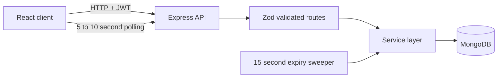
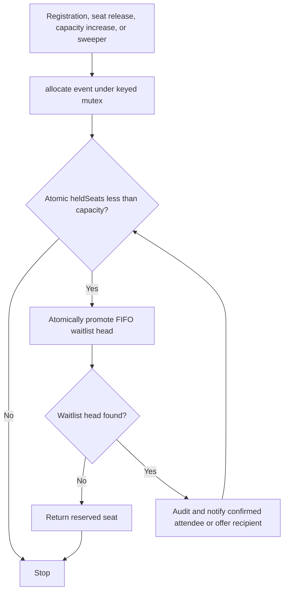
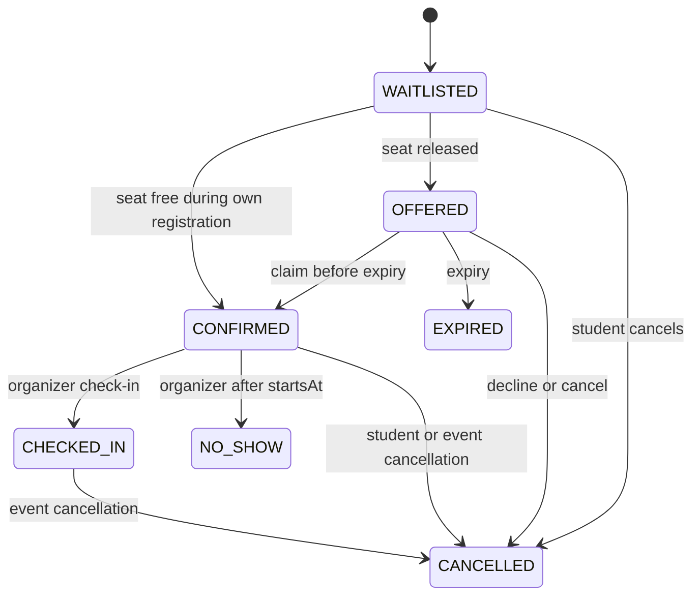

# SeatFlow

Fair, capacity-safe event registration with a first-in-first-out waitlist and time-limited offers.

**Live app:** https://seat-flow-delta.vercel.app  |  **API health:** https://seatflow-92rg.onrender.com/api/health  |  **Demo logins:** see [Deployment](#deployment)

## Problem Statement

Popular campus workshops and fest events fill within minutes. People who miss out have no fair queue: seats freed by cancellations go to whoever refreshes fastest, or stay empty because nobody tells the next person. Organizers meanwhile track registrations and no-shows by hand.

The hard part is correctness under concurrency: when many people click Register for the last seat at the same moment, exactly one of them must get it, and nobody can be confirmed twice.

## Target Users

- **Organizers:** student clubs and fest teams who run workshops, talks, and events with limited seats.
- **Students:** attendees who want to register, see where they stand in the queue, and get a fair chance at seats that open up.

## Solution

SeatFlow confirms registrations up to the event's capacity. When an event is full, students join a FIFO waitlist. When a seat is released (a cancellation, a declined or expired offer, or a capacity increase), the person at the head of the waitlist receives a time-limited offer (10 minutes by default). If they claim it, they are confirmed. If they decline or let it expire, the offer cascades to the next person in line. Organizers get an attendee list, check-in, no-show marking, event cancellation, and an audit log of every state change.

## Key Features

- **Organizers:** create, edit, publish, and cancel events; change capacity (a capacity increase immediately offers the new seats to the waitlist); view attendees grouped by status; check attendees in; mark no-shows after the event starts; review a paginated audit log.
- **Students:** browse upcoming events; register and be confirmed instantly or placed on the waitlist; see queue position; claim or decline offers with a live countdown; cancel registrations; receive in-app notifications.
- **Reliability:** no over-booking and no duplicate registrations under concurrent requests (see [Concurrency guarantees](#concurrency-guarantees)); expired offers are released both on reads and by a background sweeper.
- **Security:** bcrypt password hashing, JWT auth with role checks, ownership checks on every organizer route, request validation with Zod, Helmet, rate-limited auth routes, and CORS limited to the client origin.

## Tech Stack

- **Client:** React, Vite, React Router (polling instead of websockets)
- **Server:** Node.js, Express, Mongoose, node-cron (expiry sweeper and reconciler)
- **Database:** MongoDB (Atlas in production)
- **Auth and safety:** JWT, bcryptjs, Zod, Helmet, CORS, express-rate-limit
- **Testing:** Jest, Supertest, mongodb-memory-server (53 automated tests)
- **Hosting:** Vercel (client), Render (API), MongoDB Atlas (database)

## Architecture

### Components



All state changes live in `server/src/services/registrationService.js`. Controllers never set a registration's status directly; every transition is a guarded atomic update.

### Allocation flow

Every path that frees or adds a seat (registration, cancellation, decline, expiry, capacity increase, sweeper) goes through one function, `allocate(eventId)`.



### Registration state machine



### Project structure

```text
server/   src/ (config, models, controllers, routes, middleware, services, jobs, utils)
          scripts/ (seed.js, cleanup.js, loadtest.js)   tests/
client/   src/ (pages, components, context, hooks, services)
docs/     decisions.md, loadtest-output.txt
SPEC.md   the written design spec the project was built from
```

## Concurrency guarantees

The guarantees come from MongoDB's single-document atomic operations, not from application-level locking:

| Guarantee | How it is enforced |
| --- | --- |
| Never more seats held than capacity | Seat grab is one `findOneAndUpdate` guarded by `heldSeats < capacity` |
| No duplicate active registration (double-click) | Partial unique index on `(eventId, userId)` for active statuses, mapped to HTTP 409 |
| An offer is claimed, expired, or cancelled exactly once | Every transition filters on the expected current status; only the winner updates `heldSeats` |
| Expired offers can never be claimed | The claim update requires `offerExpiresAt > now`; expiry also runs on reads and by the sweeper |
| FIFO fairness | Each registration gets an atomic sequence number; the waitlist head is always the lowest `seq` |

A per-event in-process lock serializes allocation for one event, which makes instant confirmation deterministic on a single API instance. Safety does not depend on it: a dedicated test calls the unlocked allocator concurrently and checks that all invariants still hold. See [`docs/decisions.md`](docs/decisions.md) for why the lock and the `registering` flag both exist.

**Load test** (50 simultaneous registrations for 10 seats, plus 20 simultaneous registrations from one user), run against the deployed API:

```text
Completed 50 parallel requests in 41048ms.
HTTP status breakdown: {"201":50}
- Confirmed count: 10 (expected 10)
- Waitlisted count: 40 (expected 40)
- Held seats: 10 (expected 10)
- Unique sequence numbers: 50/50 (no duplicate seq)
>>> Scenario 1: PASS
HTTP status breakdown: {"201":1,"409":19}
>>> Scenario 2: PASS
OVERALL RESULT: PASS
```

- **Warm run:** about 41 s for 50 parallel registrations (37 s in an earlier warm run).
- **Cold-start run:** about 63 s, measured on the free tier right after a redeploy.
- Timing is dominated by round trips between the free-tier API and the database, and registrations for one event are processed in order. See [Known limitations](#known-limitations).
- The full output is in [`docs/loadtest-output.txt`](docs/loadtest-output.txt). The same test passed in repeated local runs (a 30-run soak with no failures).

## Local Setup

Requirements: Node.js 20 or newer, and a MongoDB database. The easiest option is a free [MongoDB Atlas](https://www.mongodb.com/atlas) cluster (copy its connection string). A local `mongod` also works. The automated tests do not need a database (they use an in-memory MongoDB).

```sh
git clone https://github.com/markandray/SeatFlow.git
cd SeatFlow

# API
cd server
cp .env.example .env        # then edit MONGO_URI and JWT_SECRET in .env
npm install
npm run seed                # optional: demo users and events
npm run dev                 # API on http://localhost:5001
```

In a second terminal:

```sh
cd SeatFlow/client
cp .env.example .env        # VITE_API_URL=http://localhost:5001/api
npm install
npm run dev                 # Vite prints the URL, usually http://localhost:5173
```

Set `CLIENT_ORIGIN` in `server/.env` to the URL Vite prints (default `http://localhost:5173`), otherwise the browser blocks API calls (CORS).

Demo data scripts (run from `server/`):

- `npm run seed` is idempotent: it upserts the demo accounts and recreates the four `DEMO ` events.
- `npm run cleanup` is a dry run that prints the database name, host, and what would be deleted. `npm run cleanup -- --confirm` deletes everything except the demo accounts, after you type the database name.
- `npm run reset-demo` runs the confirmed cleanup, then reseeds.

## Environment Variables

### Server (`server/.env`)

| Variable | Purpose | Example value |
| --- | --- | --- |
| `PORT` | HTTP port | `5001` |
| `NODE_ENV` | Runtime mode | `development` |
| `MONGO_URI` | MongoDB connection URI | `mongodb://localhost:27017/seatflow` |
| `JWT_SECRET` | JWT signing secret; in production it must be unique and at least 32 characters | `replace_with_a_random_secret_at_least_32_characters_long` |
| `CLIENT_ORIGIN` | Single allowed browser origin | `http://localhost:5173` |
| `OFFER_MINUTES` | Offer duration in minutes (decimals allowed, `0.5` = 30 s) | `10` |
| `ORGANIZER_INVITE_CODE` | Optional code required to sign up as an organizer | `replace_with_optional_invite_code` |

### Client (`client/.env`)

| Variable | Purpose | Example value |
| --- | --- | --- |
| `VITE_API_URL` | API base URL; must end in `/api` | `http://localhost:5001/api` |

Never commit `.env` files. Real credentials live only in untracked local files and in the hosting dashboards.

## Deployment

| Part | Host | URL |
| --- | --- | --- |
| Client | Vercel (root directory `client`) | https://seat-flow-delta.vercel.app |
| API | Render (root directory `server`, build `npm install`, start `npm start`) | https://seatflow-92rg.onrender.com |
| Database | MongoDB Atlas | n/a |

Render's free tier sleeps after inactivity, so the first request can take about a minute. Open https://seatflow-92rg.onrender.com/api/health first and wait for `{"status":"ok"...}`.

**Demo logins** (the live site is pre-seeded):

```text
Password (all demo accounts): SeatFlowDemo!2026
Organizer: demo.organizer@seatflow.test
Students:  demo.student1@seatflow.test ... demo.student5@seatflow.test
```

Suggested tour:

1. Log in as the organizer and open the dashboard: four `DEMO ` events (nearly full, full with a waitlist, open, and a draft). Open an event's attendees page to see registrations grouped by status, then try Check in.
2. Log in as a student and register for `DEMO Open Campus Event` (confirmed instantly). Log in as other demo students to see the full event's waitlist positions.
3. As a student holding a confirmed seat on `DEMO Full Workshop With Waitlist`, cancel it. The next waitlisted student sees an offer with a countdown in My Registrations.

The demo data is shared and may be reset from time to time.

## Testing

```sh
cd server && npm test        # 53 tests, including the concurrency suites
cd ../client && npm run build
```

`npm test` uses an in-memory MongoDB; the first run downloads a MongoDB binary. The suite covers authentication and ownership checks, the last-seat race, double-click registration, claim versus expiry races, offer cascades, lazy expiry, capacity changes, no-show and check-in races, event cancellation, the reconciler, and a safety test of the allocator without its lock. Each test ends by checking the invariants (held seats match active registrations, never exceed capacity, no duplicate active registration).

**Load test** (needs a reachable MongoDB; the API process and the load test must use the same database):

```sh
# terminal 1
cd server && npm run dev
# terminal 2
cd server && API_URL=http://localhost:5001/api npm run loadtest
```

It creates tagged data (`LOADTEST` events and `@loadtest.local` users), sends 50 parallel registrations and a 20-request duplicate scenario, checks the invariants, deletes its data, and writes `docs/loadtest-output.txt`. The deployed run in this repository was done by the maintainer with the deployment's own credentials (not reproducible without them), and its output is committed.

## Design Decisions

See [`docs/decisions.md`](docs/decisions.md): the partial unique index, one-at-a-time offers, safety versus liveness, expiry on read plus sweeper, the reconciler, why polling instead of websockets, the single allocation path, the `registering` flag and per-event lock (including the failed attempts that led to them), and event cancellation under the lock.

## AI Usage

This project was built with AI assistance, and the process is documented here so you can judge the work:

- **Planning and design:** I used Claude to compare project ideas against the brief, to help write the design spec ([`SPEC.md`](SPEC.md)), and to review the agent's work and diagnose problems. A few helper files (the per-event lock and a revision of the allocation service) were written with Claude's help.
- **Implementation:** most of the code was generated by a coding agent (Google Antigravity and Codex) working one session at a time from the spec.
- **What I did myself:** chose the problem and scope; ran the tests and the load tests (including a 30-run soak) and the deployed checks; performed manual mutation checks (removing a guard and confirming a test fails); found that an early timing-based fix in registration was unreliable, and had it replaced with a deterministic design (see decision 11 and 12 in `docs/decisions.md`); set up the database, hosting, and secrets; scanned the repository history for committed secrets; and clicked through every workflow locally and on the deployed site.
- No secrets are committed; `.env` files are untracked and only `.env.example` files are in the repository.

## Known Limitations

- The allocation lock is in-process and assumes one API instance (Render's free tier runs one). With several instances, a registrant could occasionally receive an offer instead of an instant confirmation; nothing would ever be over-booked.
- Registrations for one very hot event are processed in order, so a burst of 50 simultaneous registrations takes tens of seconds on the free tier.
- The free tier cold-starts after inactivity, and the background sweeper does not run while the API sleeps (correctness does not depend on it).
- Polling (5 to 10 seconds) replaces push updates, so queue positions, countdowns, and notification counts can be a few seconds stale.
- Notifications are in-app only (no email or SMS).
- Events can be cancelled but not deleted, so registrations and the audit trail stay intact.
- `npm audit` reports advisories in some dependencies (zod, node-cron/uuid on the server; react-router on the client) whose fixes require major version upgrades; they were not applied.

## License

MIT. See [`LICENSE`](LICENSE).